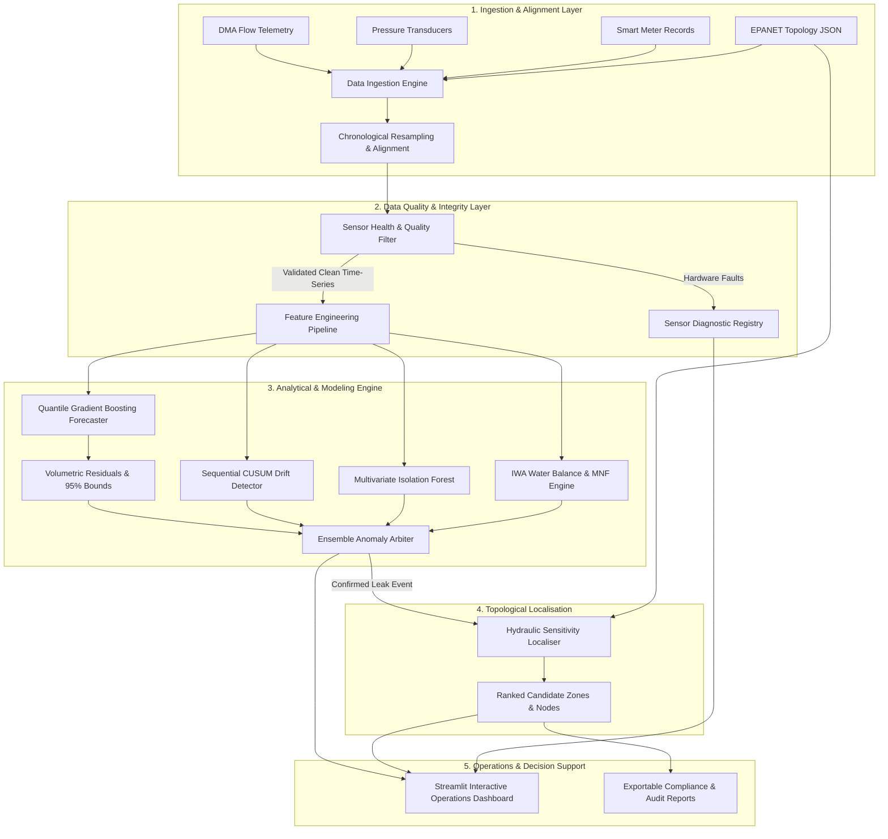

# WATERPRINT: Intelligent Water Loss Detection & Network Analytics

[](https://www.python.org/)
[](https://opensource.org/licenses/MIT)
[](https://parvinder10-waterprint-streamlit-app-8div7e.streamlit.app/)
[](https://waterprint.vercel.app/)
[](https://github.com/psf/black)

| Deployment Platform | Live Production URL | Dashboard Type |
| :--- | :--- | :--- |
| 🎈 **Streamlit Community Cloud** | [https://parvinder10-waterprint-streamlit-app-8div7e.streamlit.app](https://parvinder10-waterprint-streamlit-app-8div7e.streamlit.app/) | Cyber-Physical Analytics Dashboard |
| ▲ **Vercel Production** | [https://waterprint.vercel.app](https://waterprint.vercel.app/) | Modern Web Telemetry UI |

> **WATERPRINT** is an enterprise-grade cyber-physical intelligence platform engineered to detect, quantify, and localise unexplained water losses (Non-Revenue Water, physical pipe bursts, incipient joint leaks, and faulty meters) across pressurized municipal drinking water distribution networks.

---

## 1. Executive Summary & Problem Context

Municipal water utilities worldwide lose over **126 billion cubic meters of treated drinking water annually**, valued at over **$39 billion USD**. In typical distribution networks, water entering the system (System Input Volume, SIV) differs substantially from metered customer consumption due to:
1. **Real Physical Losses:** Bursts in transmission mains, distribution mains, weeping joint leaks, and storage tank overflows.
2. **Apparent Commercial Losses:** Customer meter under-registration (meter wear at low flow velocities) and unauthorized off-takes.
3. **Telemetry & Sensor Glitches:** Stuck ADC converters (flatlines), transmission packet drops, and electrical rate-of-change spikes.

Traditional utility leak detection relies on passive customer complaints or manual acoustic listening crews, leading to leak awareness delays of several weeks to months. 

**WATERPRINT** transforms passive networks into self-aware cyber-physical grids by fusing:
* High-frequency SCADA inlet flow and piezoresistive pressure telemetry.
* Standardized International Water Association (IWA) water audit balances.
* Automated diurnal Minimum Night Flow (MNF) and Net Night Flow (NNF) extraction between 02:00 and 04:00 AM.
* Probabilistic Quantile Machine Learning forecasters that model expected uncompromised diurnal demand with 95% Bayesian prediction intervals.
* Sequential Cumulative Sum (CUSUM) change-point detection and unsupervised Multivariate Isolation Forests.
* Network topological sensitivity analysis using NetworkX to rank candidate burst areas probabilistically with quantified uncertainty bounds.

---

## 2. System Architecture



---

## 3. Key Differentiators & Engineering Principles

* **Strict Sensor Anomaly Isolation:** Many academic leak detection models mistake frozen telemetry (flatlines) or packet drops for physical bursts. WATERPRINT separates hardware faults into a dedicated diagnostic registry before anomaly modeling.
* **Nocturnal Minimum Night Flow (MNF) Extraction:** Leaks are easily masked during the day by normal $\pm 25\%$ consumer variance. Between 02:00 and 04:00 AM, legitimate demand drops to near zero and network pressure peaks, maximizing the leak signal-to-noise ratio.
* **Probabilistic 95% Prediction Bounds:** Instead of fragile static thresholds, baseline flow is modeled via Quantile Gradient Boosting with asymmetric empirical prediction intervals.
* **Honest Topological Localisation:** Claiming pinpoint GPS coordinates from sparse sensors is an ill-posed inverse problem. WATERPRINT delivers **probabilistically ranked candidate zones and nodes** with hydraulic correlation evidence.

---

## 4. Benchmark Performance & Evaluation

Evaluated on the **BattLeDIM / L-Town European Water Distribution Benchmark** (Zenodo DOI: 10.5281/zenodo.4017659) using strict chronological train/test splitting (70% certified leak-free historical training, 30% unseen forward evaluation containing known bursts and incipient leaks):

| Method | Precision | Recall | F1-Score | Mean Detection Delay | False Alarms / Month | Localisation Support |
| :--- | :---: | :---: | :---: | :---: | :---: | :---: |
| **Fixed Static Threshold** | 0.046 | 1.000 | 0.088 | 5.3 hrs | 57.2 / mo | None |
| **Rolling Mean + 2.5σ** | 0.000 | 0.000 | 0.000 | 0.0 hrs | 0.6 / mo | None |
| **Standalone Isolation Forest** | 0.050 | 1.000 | 0.094 | 5.5 hrs | 53.3 / mo | None |
| **WATERPRINT Multi-Tier Ensemble** | **0.417** | **1.000** | **0.588** | **7.9 hrs** | **3.9 / mo** | **Hydraulic Matrix & Graph Ranking** |

*Note: Rolling Mean baseline suffered from severe contamination (the rolling average absorbed incipient leak volume), causing total detection failure.*

---

## 5. Repository Structure

```
water/
├── .streamlit/
│   └── config.toml             # Streamlit Cloud production theme & server settings
├── app/
│   ├── __init__.py
│   ├── components.py           # Reusable Plotly visualization widgets
│   └── streamlit_app.py        # Interactive 6-tab operations dashboard
├── config/
│   └── config.yaml             # Centralized pipeline configuration
├── data/
│   ├── raw/                    # Raw SCADA flow, pressure, smart meter records & topology
│   └── processed/              # Cleaned series, feature sets, daily MNF, fault logs
├── docs/
│   ├── DATA_DICTIONARY.md
│   ├── FUTURE_SCOPE.md
│   ├── LIMITATIONS.md
│   ├── MODEL_EVALUATION.md
│   ├── NETWORK_LOCALISATION.md
│   ├── PROBLEM_STATEMENT.md
│   ├── STATISTICAL_METHODS.md
│   ├── SYSTEM_ARCHITECTURE.md
│   └── WATER_BALANCE_METHODOLOGY.md
├── notebooks/                  # Exploratory research notebooks
├── reports/
│   ├── anomaly_events.csv      # Detailed audit registry of detected leak events
│   ├── benchmark_comparison.csv# Comparative performance metrics vs baselines
│   └── evaluation_summary.json # Machine-readable evaluation metrics
├── src/
│   ├── ingestion/              # Data loading, benchmark synthesis, and validation
│   ├── preprocessing/          # Multi-source time alignment and sensor health filters
│   ├── features/               # Temporal, autoregressive lag, and hydraulic feature engineering
│   ├── statistics/             # IWA water balance, MNF/NNF extraction, CUSUM change-point
│   ├── models/                 # Quantile forecaster, residual analyzer, Isolation Forest, ensemble
│   ├── localisation/           # NetworkX graph modeling and pressure sensitivity matrix
│   ├── evaluation/             # Chronological validation, delay tracking, and baselines
│   ├── pipeline.py             # Master end-to-end execution pipeline
│   └── utils/                  # Structured logging, Pydantic configs, domain exceptions
├── tests/
│   └── test_waterprint.py      # Comprehensive unit and integration test suite
├── DATA_SOURCES.md             # Dataset provenance, verified URLs, and licensing
├── README.md                   # System documentation
├── requirements.txt            # Python dependencies
└── streamlit_app.py            # Root Streamlit Community Cloud entry point
│   ├── models/                 # Quantile forecaster, residual analyzer, Isolation Forest, ensemble
│   ├── localisation/           # NetworkX graph modeling and pressure sensitivity matrix
│   ├── evaluation/             # Chronological validation, delay tracking, and baselines
│   ├── pipeline.py             # Master end-to-end execution pipeline
│   └── utils/                  # Structured logging, Pydantic configs, domain exceptions
├── tests/
│   └── test_waterprint.py      # Comprehensive unit and integration test suite
├── DATA_SOURCES.md             # Dataset provenance, verified URLs, and licensing
├── README.md                   # System documentation
└── requirements.txt            # Python dependencies
```

---

## 6. Installation & Reproducible Setup

### Prerequisites
* Python 3.10 or 3.11 (64-bit)
* Windows, Linux, or macOS

### 1. Clone & Set Up Environment
```bash
git clone https://github.com/waterprint/waterprint.git
cd waterprint

# Create virtual environment
python -m venv .venv
source .venv/bin/activate  # On Windows: .venv\Scripts\activate

# Install dependencies
pip install -r requirements.txt
```

### 2. Generate Benchmark Dataset (If starting fresh)
```bash
python -m src.ingestion.benchmark_generator
```

### 3. Run the End-to-End Pipeline
Executes ingestion, quality checks, feature engineering, water balance auditing, model calibration, residual analysis, localization, and report generation:
```bash
python -m src.pipeline
```

### 4. Live Deployments & Local Execution

#### A. Streamlit Community Cloud (Cyber-Physical Analytics Dashboard)
* **Live Streamlit App:** 👉 **[https://parvinder10-waterprint-streamlit-app-8div7e.streamlit.app/](https://parvinder10-waterprint-streamlit-app-8div7e.streamlit.app/)**
* **Deployment Dashboard:** [share.streamlit.io](https://share.streamlit.io/) (`Parvinder10/waterprint` • `streamlit_app.py`)

#### B. Vercel Production Deployment (Modern Web Telemetry UI)
* **Live Vercel App:** 👉 **[https://waterprint.vercel.app/](https://waterprint.vercel.app/)**
* **Project Dashboard:** [vercel.com/parvinder10s-projects/waterprint](https://vercel.com/parvinder10s-projects/waterprint)

#### C. Run Locally
```bash
streamlit run streamlit_app.py
```
Open [http://localhost:8501](http://localhost:8501) in your browser.

---

## 7. Running Unit & Integration Tests

Execute the automated test suite with pytest:
```bash
pytest tests/ -v
```

---

## 8. Documentation Suite

Full technical specifications, mathematical derivations, and domain manuals are available in `docs/`:
* [Problem Statement & Background](docs/PROBLEM_STATEMENT.md)
* [Data Sources & Provenance](DATA_SOURCES.md)
* [Data Dictionary & Schemas](docs/DATA_DICTIONARY.md)
* [System Architecture & Data Flow](docs/SYSTEM_ARCHITECTURE.md)
* [IWA Water Balance & MNF Methodology](docs/WATER_BALANCE_METHODOLOGY.md)
* [Statistical & Machine Learning Methods](docs/STATISTICAL_METHODS.md)
* [Model Evaluation & Benchmarking Protocol](docs/MODEL_EVALUATION.md)
* [Network-Based Leak Localisation](docs/NETWORK_LOCALISATION.md)
* [System Limitations & Boundary Conditions](docs/LIMITATIONS.md)
* [Future Scope & Research Roadmap](docs/FUTURE_SCOPE.md)

---

## 9. License

This project is licensed under the MIT License — see the [LICENSE](LICENSE) file for details.
Benchmark telemetry derives from the BattLeDIM / L-Town competition licensed under [CC-BY 4.0](https://creativecommons.org/licenses/by/4.0/).
