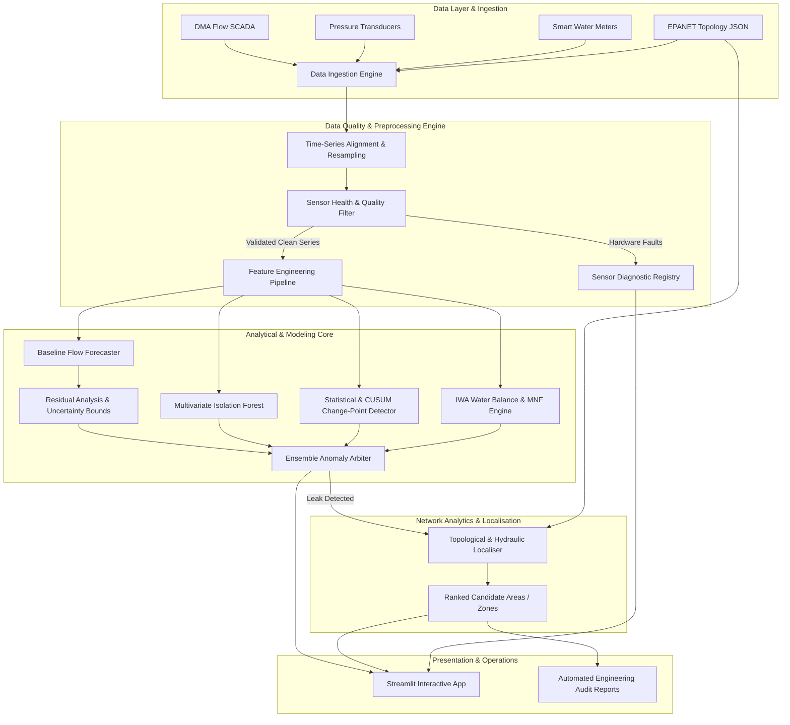

# WATERPRINT: System Architecture & Data Flow

## 1. High-Level Architectural Diagram

WATERPRINT is structured as a decoupled, multi-stage analytical engine built on clean architecture principles:

---

## 2. Component Specifications

### 2.1 Ingestion & Harmonization (`src/ingestion/`)
* **`reader.py`**: High-performance multi-source readers capable of ingesting CSV, JSON, Parquet, and relational SQL tables with automated schema validation.
* **`alignment.py`**: Resamples disparate SCADA sampling rates (e.g. 5-minute instantaneous flow, 15-minute pressure, 1-hour smart meter cumulative consumption) onto a uniform chronological grid using forward-fill with strict horizon boundaries or linear interpolation for continuous physical quantities.

### 2.2 Preprocessing & Sensor Health (`src/preprocessing/`)
* **`quality.py`**: Evaluates physical plausibility ($P_{\min} \le P \le P_{\max}$, $Q \ge 0$), detects ADC converter freezing (flatlines across $k$ consecutive periods), flags telemetry transmission dropouts, and computes rate-of-change ($\Delta P / \Delta t, \Delta Q / \Delta t$) against physical burst limits.
* **Separation Principle**: Crucially, sensor anomalies are recorded into a distinct diagnostic registry and excluded from leak anomaly models to prevent false leak alarms.

### 2.3 Feature Engineering (`src/features/`)
* **`temporal.py`**: Diurnal calendar features (hour of day, day of week, weekend indicator, trigonometric harmonic sine/cosine encodings).
* **`hydraulic.py`**: Rolling volumetric aggregations, pressure differentials between adjacent nodes ($\Delta P_{ij}$), hydraulic head loss, and Minimum Night Flow (MNF) extraction between 02:00 and 04:00 AM.
* **`lags.py`**: Autoregressive lag terms (15 min, 1 hour, 24 hours, 168 hours / 1 week) capturing seasonal autocorrelation in water consumption.

### 2.4 Statistical & Water Balance Core (`src/statistics/`)
* **`water_balance.py`**: Implements the International Water Association (IWA) standard balance:
  $$\text{Real Losses} = \text{System Input Volume} - (\text{Authorized Consumption} + \text{Apparent Losses})$$
* **`minimum_night_flow.py`**: Isolates nocturnal legitimate night consumption from background leakage and pipe burst flow using empirical residential night-use models.
* **`statistical_detectors.py`**: Exponentially Weighted Moving Average (EWMA), rolling Z-scores, and Cumulative Sum (CUSUM) drift monitoring for early incipient leak deviation.

### 2.5 Machine Learning & Residual Analytics (`src/models/`)
* **`forecaster.py`**: High-accuracy baseline flow predictor (Gradient Boosting & Ridge Fourier) that models what the flow *should be* under uncompromised conditions given calendar, temperature, and historical demand.
* **`residuals.py`**: Calculates the residual vector:
  $$r(t) = Q_{\text{observed}}(t) - \hat{Q}_{\text{expected}}(t)$$
  Applies heteroscedastic prediction intervals ($\alpha = 0.05$) to establish probabilistic bounds.
* **`isolation_forest.py`**: Unsupervised multi-dimensional anomaly detection on joint flow-pressure-residual feature spaces.
* **`change_point.py`**: Offline and online change-point detection algorithms (Pruned Exact Linear Time / CUSUM) identifying persistent step-changes characteristic of pipe rupture.

### 2.6 Topological Localisation (`src/localisation/`)
* **`graph.py`**: NetworkX-based topological representation of the water distribution network, computing shortest path distances, hydraulic connectivity, and DMA boundary clustering.
* **`sensitivity.py`**: Compares observed nodal pressure drop residuals ($\Delta P_k = P_{\text{observed}, k} - P_{\text{baseline}, k}$) against the hydraulic sensitivity matrix to rank candidate zones/nodes probabilistically.

### 2.7 Evaluation & Benchmarking (`src/evaluation/`)
* **`metrics.py`**: Chronological train/test split evaluation calculating Precision, Recall, F1-Score, Detection Delay (hours between leak initiation and first alert), and False Alarm Rate per Month.
* **`benchmark.py`**: Direct quantitative comparison of WATERPRINT's ensemble against classical baselines (fixed threshold, rolling mean threshold).

### 2.8 Operations & User Interface (`app/`)
* Interactive Streamlit dashboard providing multi-tab operational analytics:
  1. Executive Network Overview & Status.
  2. Flow, Pressure & Residual Trend Explorer.
  3. IWA Water Balance & MNF Analysis.
  4. Probabilistic Anomaly Timeline & Sensor Health.
  5. Network Topology & Ranked Candidate Leak Zones.
  6. Audit Report Generator (PDF/HTML/CSV export).
